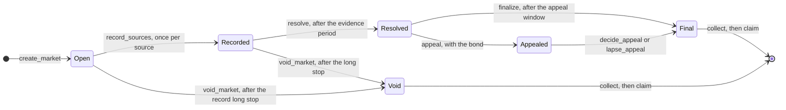

<p align="center"></p>

# PortCast - prediction markets on maritime disruption, settled from the record

**Ports, canals, shipping lanes and storms at sea. Each market freezes its criteria and its sources before anyone trades, and GenLayer validators answer it from what those sources actually reported, including when the reports disagree.**

A market asks one yes-or-no question about a disruption somewhere on the world's shipping network: a strike at a port, a canal's draft limit, a typhoon closing a terminal. People stake GEN on yes or no. When the market may be resolved, every validator reads each named source itself and they agree, word for word, on what it said; stakers can add later reports during an evidence period. Then the validators read the frozen criteria against that record and must agree on one answer. Code pays the winning side from the losing pool, or refunds everyone.

Live app: **[port-cast.vercel.app](https://port-cast.vercel.app/)**

## What it is

- **Criteria frozen before trading** - the question, what must happen for yes, what does not count, the dated window and the source links are hashed when the market opens and never change.
- **Sources nobody in the market controls** - two to four public pages from a fixed registry of publishers (port and canal authorities, weather services, international news, maritime trade press, carriers' advisories), from at least two different publishers.
- **A record agreed word for word** - each source is fetched by every validator, its visible text extracted by the contract's own code, and the leader's text kept only if it is the start of each validator's own reading.
- **Answers that can say "not settled"** - YES, NO, or no answer when the record does not establish either; no answer refunds every stake.
- **Real stakes, tracked to their owners** - parimutuel pools, one bonded appeal, long stops on every stage, and a pull ledger.

## How it works

### For a trader

1. Find a market on the map or the board, and read its criteria and sources.
2. Stake on yes or no before trading closes; the page shows what the stake would collect at today's pools.
3. During the evidence period, file up to two later reports from registry publishers if the named sources miss something.
4. If the answer goes against you, appeal once with the bond and add pages for the appeal.
5. When the market is final, collect your share, then draw it from the bar at the top.

### For a market creator

1. Open the studio, start from a template (strike, canal restriction, storm closure, transit suspension) and place the market on the map.
2. Write the criteria; the studio flags words a resolver could read two ways and missing thresholds before anything is signed.
3. Name the sources from the registry and set when trading closes and when the market may be resolved.
4. Read the edge cases the studio lists, then sign: the terms are frozen from that moment.

## Answers

| Answer | Meaning | Money |
|---|---|---|
| `YES` | The recorded pages establish every element of the criteria inside the window, and no exclusion applies | The yes side shares the no pool in proportion to its stakes |
| `NO` | The recorded pages establish that the criteria were not met | The no side shares the yes pool |
| `NO_RESOLUTION` | The pages do not address the question, or contradict each other with no basis to prefer one account | Every stake is refunded |

If nobody staked on the winning side, every stake is refunded. An appeal's bond comes back if the appeal changes the answer; otherwise it joins what the final answer pays out.

## Lifecycle



| State | Leaves by |
|---|---|
| Open | `stake` until trading closes; `record_sources` once per named source from the resolution time; `void_market` after the record long stop (14 days) |
| Recorded | `file_page` by stakers during the evidence period; `resolve` after it; `void_market` after three further periods |
| Resolved | `appeal` by a staker the answer did not pay, inside the appeal window; `finalize` after it |
| Appealed | `file_page` for the appeal; `decide_appeal` after its evidence period; `lapse_appeal` after three further periods |
| Final or void | `collect` by each staker, then `claim` |

## GenLayer consensus functions

| Function | Kind | What runs under consensus |
|---|---|---|
| `record_sources` | `gl.vm.run_nondet` | One named source per round: each node fetches the page and extracts its text in contract code; the leader's text must be the start of every validator's own reading and not much shorter, and a page the leader calls unreadable must be unreadable to the validator too. |
| `file_page` | `gl.vm.run_nondet` | The same check for a page a staker files. |
| `resolve` / `decide_appeal` | `gl.vm.run_nondet` | Each node reads the frozen criteria against the recorded pages, never a fresh fetch, and answers YES, NO or NO_RESOLUTION; validators must agree on that word. The reasons and the per-page notes are the leading validator's. |

Only the answer moves money. Pools, shares, bonds and refunds are computed in code from the agreed answer.

## Contract

| | |
|---|---|
| Network | GenLayer Studio Next, chain 61997 |
| RPC | `https://studio-dev.genlayer.com/api` |
| Deployment of record | [`0xA115DbeA84FaA56527e93923670b79933065d4cE`](https://explorer-studio-dev.genlayer.com/address/0xA115DbeA84FaA56527e93923670b79933065d4cE) |
| Source | [`contracts/portcast.py`](contracts/portcast.py), sha256 `9c33b2f659b7d58811b9a265e314d805c9ec86000cf9108638078b182bc8422d`, verified byte for byte |

### Write methods

| Method | Who | Payable | Notes |
|---|---|---|---|
| `create_market` | Anyone | | Question, kind, place, criteria, exclusions, window, trading close, resolution time, 2 to 4 registry sources, periods |
| `stake` | Anyone | Yes, at least 0.01 GEN | Yes or no, until trading closes; refusals return and credit back |
| `record_sources` | Anyone, from the resolution time | | One named source per call, under consensus |
| `file_page` | A staker | | Two per staker and four per side, per stage |
| `resolve` | Anyone, after the evidence period | | The answer, under consensus |
| `appeal` | A staker the answer did not pay | Yes, the bond | Once; 5% of the pools, at least 0.05 GEN |
| `decide_appeal` | Anyone, after the appeal's evidence period | | Final answer, under consensus |
| `lapse_appeal` | Anyone, after the long stop | | The first answer stands, the bond returns |
| `finalize` | Anyone, after the appeal window | | The answer becomes final |
| `void_market` | Anyone, after a long stop | | Every stake refunded |
| `collect` | A staker | | Moves the position's share into the ledger |
| `claim` | Anyone owed | | The only method that sends value |

### Read methods

`get_config` (limits and the publisher registry), `get_stats`, `list_markets`, `markets_of`, `get_market` (with its record and every round), `get_position`, `get_balance`.

## Replay markets

A market whose window has already ended when it opens is marked as a replay. It lets the whole path run on events that have already been reported, and the app says so wherever one appears; nothing in a replay is a forecast.

## Verified end-to-end

See [`docs/live-proof.md`](docs/live-proof.md): three markets on real reporting, run on the deployment of record, 88 checks across 46 transactions, every round agreed at the first ask:

| Market | Answer |
|---|---|
| Ningbo-Zhoushan, Typhoon Saudel (Asia) | YES, then NO on appeal: the pages give a 78-hour total, not one continuous 72-hour closure; the appeal changed the answer and its bond came back |
| Panama Canal draft (Central America) | NO: the cut to 47.5 feet was postponed outside the window |
| Hamburg seaport strike (Europe) | NO: one source refused plain fetches and was agreed unreadable |

Ten of the twelve writes ran live; `lapse_appeal` and `void_market` wait on long stops (up to 14 days) and are covered by the direct tests.

## Tech stack

| Layer | Tools |
|---|---|
| Contract | Python on GenVM, `gl.nondet.web.get`, `gl.nondet.exec_prompt`, an HTML-to-text extractor in contract code |
| Tests | pytest direct mode with stubbed fetches and models, random invariant walks, mutation sweeps |
| App | Next.js 16, React 19, Tailwind 4, d3-geo, genlayer-js 2.0.0-rc.1, Transaction Kit 0.1.0-rc.2 |

## Getting started

```bash
pip install -r requirements.txt
```

```bash
python -m pytest tests/direct -q
```

```bash
cd web && pnpm install && pnpm dev
```

## Security

See [`docs/security.md`](docs/security.md) for what was checked before the deployment of record and the limits that remain.

## Disclaimer

A demonstration on a test network. Public reporting can be wrong, late or incomplete; a market is only as good as the sources it names and the criteria it writes.
